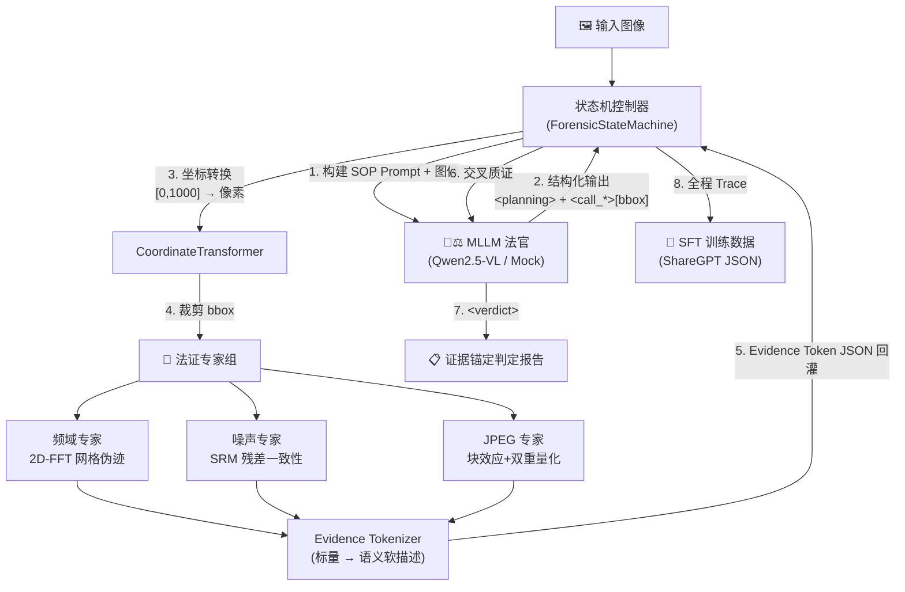
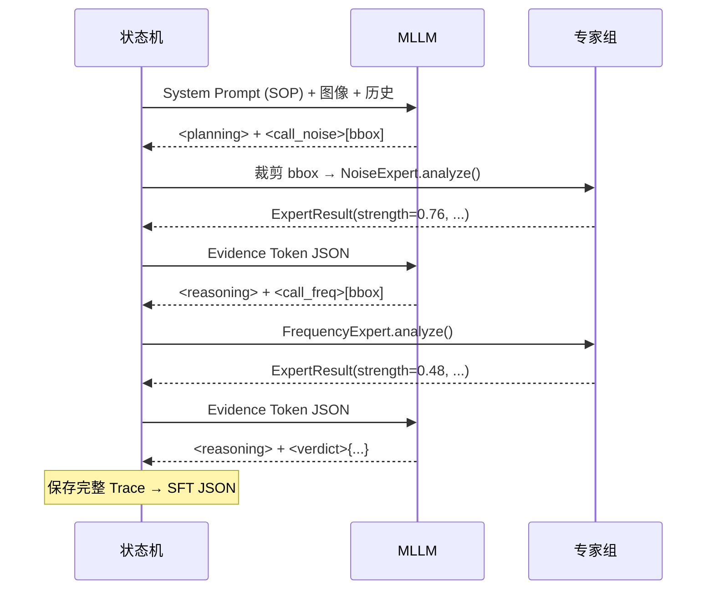

# Forensic-Agent

**主动探索型双分支图像取证系统**
MLLM 驱动、法证证据锚定的 AI 生成图像检测，输出可解释的法证报告。

> **先读 §0：当前版本与入口。** 本文档 §1–§6 描述现在的系统；§7 起为**历史档案**
> （计划、进展、旧路线），保留备查，不再是当前指令。

[](https://www.python.org/)
[](https://pytorch.org/)
[](./LICENSE)
[](./tests/)

---

---

## 0. 当前版本（工程收口，2026-10-13）

**当前任务**：全局 AI 生成检测（Real / Fake）。**Qwen 主导调用与结案，控制器负责执行与安全约束**，
参考后验只作对照、不覆盖标签。**默认策略就是当前版本 v3**（历史复算才显式
`FORENSIC_HALTING_POLICY=v2`）：

```bash
python main.py --image <path/to/image>                                 # 唯一推荐启动命令（v3）
FORENSIC_HALTING_POLICY=v2 python main.py --image <path>               # 仅用于历史复算
```

**权威文档（只描述当前代码）**：

| 文档 | 内容 |
|------|------|
| [`CURRENT_PROGRAM_ARCHITECTURE.md`](CURRENT_PROGRAM_ARCHITECTURE.md) | 当前任务、角色分工、入口、真实可用的专家、运行时序、版本记录规则 |
| [`KNOWN_ISSUES.md`](KNOWN_ISSUES.md) | 未完成问题清单（已实现待验证 / 尚未修复 / 暂缓），每项带验收条件 |
| [`sft_data/BATCH_INVENTORY.md`](sft_data/BATCH_INVENTORY.md) | 批次台账：历史 / 待审核 / 合格训练三类材料与各自的版本记录 |
| [`TESTING.md`](TESTING.md) | 测试三层（core / module / full）与"换专家后哪些测试退役" |

**当前实际可用的专家**：`probe`（外部权重，主检测器）、`noise`、`jpeg`、`freq`
（后三者计划退出工具箱）。`frequency`(v1)、`ela` 已退役；`trufor` 不在全局主链，仅作对照。

**三条不可混淆的规则**：

1. 默认即当前策略 v3；历史复算显式选 v2。报告必须核对策略、提示词指纹与校准表身份
   （每个批次目录的 `VERSIONS.json`）。
2. **重新渲染工作台 ≠ 重新生成轨迹**；**自动检查通过 ≠ 允许训练**。进 SFT 的唯一路径是
   `record_review --import` → `apply_review` → `build_final_v2`（门禁）。
3. 未审核批次（含 g7_b1、g7_b2）**不得用于 SFT**；因缺陷作废的批次归档在
   `sft_data/trajectories_<id>_<原因>/`，不参与任何统计。

---

## 1. 项目概览

多模态大语言模型（MLLM，如 GPT-4o、Qwen2.5-VL）长于高层语义理解，却对频域伪迹、微观噪声分布、JPEG 压缩痕迹等底层物理法证特征处于"睁眼瞎"状态——其视觉编码器（CLIP）在下采样过程中丢弃了这些关键信息。

**本系统**将 MLLM 作为"法官"，与传统法证"专家组"结合，构建主动探索式闭环：

1. MLLM 扫描图像，锁定可疑区域（Planning）
2. 按需**主动调用**法证专家（`freq` / `noise` / `jpeg`），传入具体 bbox
3. 专家输出被抽象为结构化 **Evidence Token**（含物理现象描述 + 置信度）
4. MLLM 交叉质证全部证据，生成证据锚定的可解释真伪判定报告

> **学术差异点**：FakeXplain 教模型推理人类标注的可见伪迹，而本方法教模型推理**机器提取的法证级证据**。

**适用场景**：AIGC 图像检测、数字图像取证、可解释 AI 判定系统。当前支持单张静态图像；视频支持为后续规划（见 §7 路线图）。

---

## 2. 系统架构

### 2.1 整体数据流



### 2.2 状态机主循环



### 2.3 模块职责

| 层 | 模块 | 职责 |
|----|------|------|
| 控制 | `state_machine/controller.py` | 主循环编排：解析 → 执行专家 → 注入证据 → 终止判断 |
| 控制 | `state_machine/halting.py` | 四重终止守卫（verdict / budget / conflict / info_gain） |
| 控制 | `state_machine/evidence_tokenizer.py` | 标量 → 语义映射 + Evidence Token Schema 构建 |
| 模型 | `mllm/qwen_client.py` | 真实 Qwen2.5-VL 推理 + 格式纠错反馈环 |
| 模型 | `mllm/mock_client.py` | 模板驱动 Mock（4 种行为模式，CPU 测试用） |
| 模型 | `mllm/message_builder.py` | 多轮消息构建：原图 + 诊断区域裁剪图（G1） |
| 专家 | `experts/frequency.py` / `frequency_v2.py` | 2D-FFT 功率谱周期峰值检测 |
| 专家 | `experts/noise.py` | SRM 高通滤波 + 局部方差不一致性 |
| 专家 | `experts/jpeg.py` | 8×8 块效应 + DCT 直方图双重量化 |
| 工具 | `utils/parser.py` | 正则解析 XML 标签 + 容错归一化 |
| 工具 | `utils/coordinate_transformer.py` | 双空间坐标转换（normalized_1000 ↔ pixels，G1） |
| 工具 | `utils/evidence_consistency.py` | 证据方向一致性门：strength 与论述方向必须一致（G1） |
| 工具 | `utils/logger.py` | SessionLogger（SFT Trace）+ 操作审计日志 |

---

## 3. 快速开始

### 3.1 环境要求

- Python 3.12+
- **CPU 模式**：完全可用（专家算法 + Mock MLLM 无需 GPU）
- **GPU 模式**：真实 Qwen2.5-VL 推理需 RTX 4090（24 GB）或同等显存

### 3.2 安装

```bash
pip install -r requirements.txt
```

### 3.3 数据挂载

项目假定以下数据目录已就位（见 `agent.md` §4）：

```
dataset/
├── Real/                    # 1000 张真实照片 (JPEG)
└── GenImage_Test/           # 8000 张 AI 生成图 (PNG)，8 个子目录
    ├── ADM/  BigGAN/  Glide/  Midjourney/
    └── SD14/ SD15/    VQDM/   Wukong/
```

### 3.4 模型资产

| 项目 | 路径 / 说明 |
|------|-------------|
| 模型 | Qwen2.5-VL-7B-Instruct（16.6 GB，5 × safetensors） |
| 路径 | `/root/autodl-tmp/psychology_video_project/models/models/qwen--Qwen2.5-VL-7B-Instruct/snapshots/master` |
| 配置 | `config.py` → `QWEN_MODEL_PATH` |
| 显存 | FP16 ~16 GB（RTX 4090 可承载） |

> ⚠️ 加载模型权重前必须获得用户 GPU 授权（见 `agent.md` §3.2）。

### 3.4b 外部专家权重（PROBE-DINOv2 / TruFor）— 获取方式、哈希、不再分发

这两个专家是 G7 引入的**外部依赖**：代码与权重都**不在本仓库内**，本项目**不附带、不再分发**，获取方式与许可见其原始页面。缺依赖时项目照常运行、测试照常通过（适配器是**可选惰性依赖**，只有显式启用时才导入）。

| 专家 | 本项目中的路径 | 来源 | sha256 | 许可 |
|------|---------------|------|--------|------|
| **PROBE-DINOv2**（主检测器） | `/root/autodl-tmp/third_party/probe/DINOv2_best_model_step_34999.pth`（1217.7 MB）；主干 `facebook/dinov2-with-registers-large` 经 `hf-mirror.com` | ModelScope `shuinishaojiu/PROBE-AIGI-Detection` | `c8caa9ba…a450156` | ⚠️ **上游未声明**（仓库无 LICENSE）。**用户授权**（2026-10-11，本地研究）≠ **上游许可**：仅本地研究可运行，不得再分发 |
| **TruFor**（L1 研究对照，不接线） | `/root/autodl-tmp/third_party/TruFor/pretrained_models/trufor.pth.tar`（281.5 MB） | GRIP-UNINA `TruFor_weights.zip`（MD5 `7bee48f3476c75616c3c5721ab256ff8`） | `ac1d90e3…578c7844` | ⚠️ **仅限信息性与非营利用途**；本项目不再分发 |

- 运行时每个 Evidence Token 都会带上**来源 URL、权重的 sha256（带副文件缓存）、输入预处理描述**，见 `experts/external_base.py` 的 `WeightProvenance`。
- 网络：本机 `raw.githubusercontent.com` 与 `huggingface.co` **不通**，获取走替代源（`ghfast.top` / `cdn.jsdelivr.net` / `hf-mirror.com` / ModelScope）。
- **论文引用仅为学术归属，不构成使用授权。**

```bash
# 适配器与评测（CPU 可跑 Mock；真实推理需 GPU 授权）
python scripts/g7_smoke_external.py --expert probe_dino        # 冒烟 + 显存/耗时采样
python scripts/evaluate_external_expert.py --expert probe_dino --group A   # 分组评测
python scripts/g7_baselines.py --fit-select                               # A 拟合 / B 选择 / 写冻结
python scripts/g7_baselines.py --validate-c                               # 冻结后才可读 C
```

### 3.5 单张图像分析

```bash
# CPU 模式（Mock MLLM）
python main.py --image dataset/GenImage_Test/Midjourney/0_midjourney_169.png

# GPU 模式（真实 Qwen2.5-VL）
python main.py --image dataset/GenImage_Test/Midjourney/0_midjourney_169.png --mllm qwen
```

### 3.6 批量分析

```bash
python main.py --batch Real --max 5          # Real 子集（限 5 张）
python main.py --batch Midjourney            # 全部 Midjourney
python main.py --batch all --max 10          # 全部类别，每类 10 张
```

### 3.6b G4 数据管线（CPU 全流程，除轨迹生成需 GPU）

```bash
python scripts/build_split_v2.py            # 1) 源级划分（9000 源，防泄漏 + 校准源 holdout）
python scripts/build_variants_g4.py --sources 20   # 2) 训练源的格式变体（类别配平抽样）
python scripts/generate_trajectories_g4.py --dry-run --limit 1   # 3) 轨迹生成（Mock 验证管线）
python scripts/generate_trajectories_g4.py         #    真实生成（需 GPU 授权）
python scripts/admit_trajectories_g4.py     # 4) 两级准入（仅读训练分区）
python scripts/build_final_v2.py            # 5) 组装 final_v2 并过十项校验
python scripts/build_review_workstation.py  # 6) 生成审核工作台（sft_data/review/index.html）
# 人工审核（单次全量）：浏览器打开 index.html，逐条按 1–4 快捷键给处置，
# 决定存在浏览器本地；改完点「导出全部决定」得到 review_decisions.json
python scripts/record_review.py --import review_decisions.json --reviewer <你>   # 写回仓库
python scripts/record_review.py --sample <id> --reviewer <你> \
    --decision accept|format_only|revise|reject --notes "…"      # 也可单条记录
python scripts/record_review.py --summary   # 审核进度
python scripts/apply_review.py              # 7) 按处置出训练集（未审完会拒绝运行）
```

### 3.7 Mock 行为模式（CPU 调试）

```bash
python main.py --image path/to/img.png --mode fast_verdict   # 2 轮快速结案
python main.py --image path/to/img.png --mode two_calls      # 2 轮均衡（默认）
python main.py --image path/to/img.png --mode explore_all    # 遍历 3 个专家
python main.py --image path/to/img.png --mode conflict       # 制造证据冲突
```

### 3.8 运行测试

```bash
pytest tests/ -v              # 运行当前测试集
pytest tests/test_pipeline.py # 仅端到端测试
```

---

## 4. 工程目录

```
innovation_project/
├── main.py                         # CLI 入口（--image / --batch / --mllm / --mode）
├── config.py                       # 集中配置：路径、阈值、System Prompt、sigmoid 参数
├── requirements.txt                # 依赖清单
│
├── experts/                        # 法证专家模块（纯 CPU）
│   ├── base.py                     # BaseExpert 抽象类 + ExpertResult 数据结构
│   ├── frequency.py                # 2D-FFT 功率谱峰值检测（v1）
│   ├── frequency_v2.py             # 多尺度 FFT（全图 + 50% 降采样，v2）
│   ├── noise.py                    # SRM 高通滤波 + 局部方差不一致性
│   └── jpeg.py                     # 块效应度量 + DCT 双重量化检测
│
├── mllm/                           # MLLM 客户端抽象层
│   ├── base.py                     # BaseMLLMClient 抽象接口
│   ├── mock_client.py              # 模板驱动 Mock（4 种行为模式，CPU）
│   ├── message_builder.py          # Qwen 多轮消息构建（原图 + 区域裁剪图，G1）
│   └── qwen_client.py              # 真实 Qwen2.5-VL 客户端（GPU）+ 格式纠错环
│
├── state_machine/                  # 状态机核心
│   ├── controller.py               # 主循环：解析→执行专家→Evidence Token 注入→终止
│   ├── halting.py                  # 四重终止守卫（verdict/max_steps/conflict/info_gain）
│   └── evidence_tokenizer.py       # ExpertResult → Evidence Token Schema JSON
│
├── utils/                          # 工具层
│   ├── image_utils.py              # 图像加载 / 裁剪 / 灰度化 / RGBA 处理
│   ├── coordinate_transformer.py   # [0,1000] 相对 ↔ 绝对像素坐标
│   ├── parser.py                   # 正则解析器（XML 标签 + 容错归一化）
│   ├── evidence_consistency.py     # 证据方向一致性门（G1）
│   └── logger.py                   # SessionLogger (ShareGPT) + 操作审计日志
│
├── scripts/                        # 批处理脚本
│   ├── calibrate_experts.py        # 专家 sigmoid 参数 ROC 校准
│   ├── build_calibration_set.py    # G2 格式配平校准集（2×4 网格 + 扰动）
│   ├── evaluate_experts_g2.py      # G2 专家区分度/稳定性/适用条件评估
│   ├── build_reliability_table.py  # G2 分箱校准表与适用性标签生成
│   ├── qwen_gain_baseline.py       # G2-d/G3-e 四条件增益对比（Mock 干跑 / GPU，带配置指纹与续跑）
│   ├── analyze_g2_gain.py          # G2-d 统计推断（McNemar / Bootstrap AUROC CI）
│   ├── analyze_gain_mechanism.py   # G2-d 机制分析（token 方向跟随、Bundle 自洽性、视觉泄漏）
│   ├── replay_halting_g3.py        # G3-c 停止策略 v1/v2 离线回放对比
│   ├── build_split_v2.py           # G4-a 源级 train/val/test 划分（防泄漏 + 校准源 holdout）
│   ├── build_variants_g4.py        # G4-b 训练源的格式变体（复用校准集编码路径）
│   ├── generate_trajectories_g4.py # G4-b 六策略候选轨迹生成（Mock 干跑 / GPU）
│   ├── admit_trajectories_g4.py    # G4-c 两级准入（条件层 + 增益层，仅用训练分区）
│   ├── build_final_v2.py           # G4-d 组装 final_v2 并过十项校验
│   ├── build_review_workstation.py # G4-f 审核工作台（完整训练对话 + 证据语义 + 浏览器内保存决定）
│   ├── record_review.py            # G4-f 处置记录（append-only JSONL，支持导入浏览器导出/CSV）
│   ├── apply_review.py             # G4-f→g 按处置出训练集（未审完拒绝运行）
│   ├── train_lora_g4.py            # G4-g LoRA 试训（监督全部助手轮；掩码位置交叉熵省显存）
│   ├── check_acceptance_g5.py      # G5 验收核对器（六条判据 + 容器理由扫描）
│   ├── generate_sft_data.py        # A/B 双线 SFT 数据规模化生成（GPU）
│   ├── build_sft_data.py           # 四类 SFT 数据构造（合成）
│   ├── finalize_sft_data.py        # A 线筛选 + 数据整合 → final/
│   ├── audit_sft_conflicts.py      # 伪冲突自动隔离与拒绝集维护
│   └── audit_sft_correct.py        # correct 结构审计 + 全量处置状态标记
│
├── tests/                          # CPU 单元测试与端到端测试
├── sft_data/train/final/           # 旧版 SFT 候选集（509 条，冻结作回归基线）
├── sft_data/train/final_v2/        # G4 生成的 final_v2（237 条，十项校验 0 拒绝）
├── sft_data/train/final_v2_reviewed/  # 人工审核后按处置分集的训练集（待生成）
├── sft_data/split_v2.json          # G4-a 源级划分（9000 源，含校准源 holdout 与采样权重）
├── sft_data/variants/              # G4-b 格式变体（图像 gitignore，manifest 入库）
├── sft_data/trajectories/          # G4-b 轨迹记录（440 条，六策略）
├── sft_data/admission_report.json  # G4-c 逐轨迹准入判定与理由
├── sft_data/review/                # G4-f 审核工作台（237 页 + 工作单 + 高风险标记，单次全量审核）
├── calibration/                    # 专家校准集、可靠性表、G2-d/G3-e 增益与回放报告
├── traces/sft_sessions/            # 管道运行的原始 Trace（ShareGPT）—— 真实会话入库作为 SFT provenance
├── traces/evidence/                # 诊断区域裁剪图（运行期生成，未纳入版本控制）
├── traces/dry_run_sessions/        # Mock 干跑 Trace（与真实会话隔离，未纳入版本控制）
└── claude_operation_log.md         # 开发操作审计日志
```

---

## 5. 接口规范（API & Schemas）

### 5.1 Evidence Token Schema

专家输出经 `EvidenceTokenizer` 抽象为统一 JSON 后注入 MLLM 上下文：

```json
{
  "evidence_id": "E-1a2b3c4d5e",
  "evidence_name": "noise_residual_inconsistency",
  "region": "patch_coordinates_[380, 220, 720, 580]",
  "region_pixels": [380, 220, 720, 580],
  "region_normalized_1000": [371, 275, 703, 725],
  "coordinate_space": "pixels",
  "region_semantics": "diagnostic_evidence_region",
  "phenomenon": "Localised noise variance measures abnormally (inconsistency ratio: 3.2802). Variance collapse or inflation detected.",
  "reasoning": "Significant localised noise variance anomaly detected. Real camera sensors produce spatially homogeneous micro-noise (shot noise + PRNU)...",
  "strength": 0.7630,
  "source": "noise_expert",
  "support": "AI-generated",
  "interpretation_text": "Severe statistical anomaly matching artificial generative fingerprints."
}
```

> 当前 `final/` 是旧版数据的诊断结果，不是已经通过训练准入的最终数据。`correct` 只保证答案与 GT 一致，`borderline` 高度模板化，`format` 只能作为格式专用数据。后续在 Expert 与停止策略更新后生成独立的 `final_v2/`。

| 字段 | 类型 | 说明 |
|------|------|------|
| `evidence_name` | str | 证据标识（如 `abnormal_high_frequency_residual`） |
| `region` | str | 分析区域（绝对像素坐标） |
| `phenomenon` | str | 物理现象描述（含实测数值） |
| `reasoning` | str | **条件化**物理解释（随 strength 三段式变化） |
| `strength` | float | 归一化异常值 ∈ [0, 1] |
| `source` | str | `frequency_expert` / `noise_expert` / `jpeg_expert` |
| `support` | str | `Real` / `AI-generated` / `Uncertain` |
| `interpretation_text` | str | 语义软描述（强度映射字典） |

### 5.2 强度映射字典（Discretized Text Mapping）

| strength 区间 | support | interpretation_text |
|--------------|---------|---------------------|
| 0.0 ≤ s < 0.3 | Real | Statistical patterns align with normal hardware camera capture. |
| 0.3 ≤ s < 0.7 | Uncertain | Mild mathematical distortions noted; localized compression or blurring suspected. |
| 0.7 ≤ s ≤ 1.0 | AI-generated | Severe statistical anomaly matching artificial generative fingerprints. |

### 5.3 MLLM 输出标签协议（SOP）

| 标签 | 格式 | 说明 |
|------|------|------|
| `<planning>` | 文本块 | 必含 Suspected Region / Visual Anomalies / Expert Target & Hypothesis |
| `<call_freq\|noise\|jpeg>` | `[ymin, xmin, ymax, xmax]` | bbox 范围 [0, 1000]（对齐 Qwen2.5-VL 规范） |
| `<reasoning>` | 文本块 | 物理-语义一致性校验 + 环境污染质询 |
| `<verdict>` | JSON | 见下方 Schema |

### 5.4 Verdict Schema

```json
{
  "verdict": "Fake",
  "confidence": 0.86,
  "primary_evidence": ["noise_residual_inconsistency"],
  "report": "面部区域经法证分析确认存在显著的噪声方差塌陷（65%）..."
}
```

| 字段 | 取值 | 说明 |
|------|------|------|
| `verdict` | `Real` / `Fake` / `Uncertain` | 三分类判定 |
| `confidence` | 0.0 – 1.0 | 置信度（证据冲突时主动降低） |
| `primary_evidence` | str[] | 支撑判定的证据名称列表 |
| `report` | str | 可解释法证报告 |

### 5.5 SFT 训练数据 Schema（ShareGPT）

```json
{
  "id": "forensic_sft_session_xxx",
  "type": "correct | conflict | borderline | format",
  "ground_truth": "Fake",
  "final_verdict": { "verdict": "Fake", "confidence": 0.86, "..." : "..." },
  "conversations": [
    { "from": "user", "value": "<image>\n请分析这张图像的真实性..." },
    { "from": "gpt",  "value": "<planning>...</planning><call_noise>...</call_noise>" },
    { "from": "user", "value": "{\"evidence_name\": \"...\", \"strength\": 0.76, ...}" },
    { "from": "gpt",  "value": "<reasoning>...</reasoning><verdict>{...}</verdict>" }
  ],
  "evidence_chain": [ "..." ],
  "metadata": { "total_steps": 2, "halting_reason": "verdict_output" }
}
```

---

### 5.6 G4 数据管线 Schema

**划分（`sft_data/split_v2.json`）**：泄漏单元是**源图**，同一源的 native/png/q95/q85/q70 必归同一分区。

```json
{"version": "split_v2", "seed": 20260926, "hash": "d8e9d81597ead53f",
 "counts": {"train": {"sources": 8332, "labels": {...}}, "val": {...}, "test": {...}},
 "train_sampling_weights": {"Real": 1.0, "Fake": 11.53},
 "holdout": {"Hard/x": "calibration_g2b"},
 "sources": {"ADM/49_adm_153": {"split": "train", "path": "...", "label": "Fake",
             "generator": "ADM", "resolution": [256, 256]}}}
```

**轨迹记录（`sft_data/trajectories/<variant>__<policy>.json`）**：`policy` 与 `tools_served`（六策略之一）、`model_candidate`（模型原始判断）、`final_verdict`/`confidence`/`posterior`/`policy_reasons`（停止策略）、`evidence[]`（完整 Evidence Bundle）、`counters`（轮/调用/唯一证据/抑制/加权成本）、`elapsed_s`、`scores`（模型概率与结构化后验各自的 NLL/Brier）。

**准入判定（`sft_data/admission_report.json`）**：逐轨迹 `category`（positive / honest_abstention / reject）、`conditional_ok`、`risk_reduced`、`brier_delta`、`cost_delta`、`reasons[]`；报告含 `no_tool_positive_labels` 记录无工具桶的标签构成。

**final_v2 样本（`sft_data/train/final_v2/sft_*.json`）**：四段式训练目标

```text
<observation>         可直接核验的视觉事实（含模型首轮观察）
<forensic_evidence>   evidence_id / 专家 / 测量范围 / 原始数值 / 校准概率 / 适用性 / 适用条件
<reasoning>           支持证据、反证与替代解释、专家失效条件、剩余不确定性
<verdict>             {"verdict", "confidence", "basis": model_perception|evidence_posterior, "posterior"?}
```

`metadata` 携带 `admission_category`、`counters`、`scores`、`split`，以及集级 `label_composition` 与 `training_weights`。

**浏览器存储按批次隔离**（2026-10-13 修复）：存储键是 `finalv2review.v1:<批次 id>:<内容指纹>`，页面自带**本批次的样本 id 列表**——进度只统计本批次、导出只包含本批次决定（并提示"另有 N 条属于其他批次，未导出"）、导入会核对 `batch_id` 与 `batch_fingerprint`，不符即拒绝并说明。页面还记录它读取旧共享键的那一批次（`g7_b1`）：打开该批次页面时会**复制**（不移动、不删除）旧记录，因此修复前浏览器里已有的 145 条决定不会丢失，也不会串到别的批次。

**审核记录（`sft_data/review/dispositions.jsonl`）**：一行一条，`{"sample_id", "reviewer", "decision", "notes", "recorded_at"}`，同一样本以最新为准（日志式，永不重写）。浏览器里做的决定存在 `localStorage`，导出的 `review_decisions.json`（或填好的 `worklist.csv`）由 `record_review.py --import` 读入，走与单条记录相同的校验；重复导入同一文件不会重复记账。**审核是一次全量通读**，`review_sets.json` 里的 `high_risk` 只是提示重点，不触发第二次阅读。

---

## 6. 法证专家与终止机制

### 6.1 专家准入（G2 标定后的实测口径）

G2-b 在格式配平校准集上测得每个专家的**真实方向**，与最初的理论相反；G2-e 据此逐个准入：

| 专家 | 算法 | 实测方向 | 逐格分离度（极性校正） | 准入 |
|------|------|----------|------------------------|------|
| **频域 v1** (`freq`) | Hanning 窗 → 2D-FFT → 高频径向峰值 | 无信号 | 0.505 | **停用**，不注册 |
| **频域 v2** | 多尺度 FFT | 对齐但弱 | 0.556 → q70 0.634 | 注册为 `frequency_expert_v2`，**仅佐证** |
| **噪声** (`noise`) | SRM 5×5 高通 → 局部方差 vs 全局方差 | **反向**：高残差 = Real（相机微噪声） | native 0.847 / png 0.845 / q95 0.823 / q85 0.784 / q70 0.772 | **保留**，主力（跨格式最稳定） |
| **JPEG** (`jpeg`) | 8×8 块边界梯度比 + DCT 直方图挖空 | **反向**：高结构 = Real（JPEG 来源史） | png 0.972 / q95 0.717 / q85 0.734 / **q70 0.431** | **保留 + 限制**：q70 失效区禁止进入轨迹 |
| **ELA** | 误差水平分析 | 压缩历史捷径 | png 0.948 → q70 0.504 | **不注册**（能力等同压缩历史，运行期不可知） |

**外部专家（G7，非本仓库代码/权重，见 §3.4b）**：

| 专家 | 方法 | 方向 | 实测判别力（按源 CI） | 处置 |
|------|------|------|----------------------|------|
| **PROBE-DINOv2** | DINOv2-L + 线性头；336 滑窗 → 均值 logit → sigmoid = P(AI-generated) | **正向**（无需校正） | A 组 0.960 [0.924, 0.986]：native 0.967 / png 0.973 / q95 0.977 / q85 0.987 / **q70 0.995**；**未见生成器 0.952**；C 组独立验证 **0.986** | **准入，主检测器**（入口 3 接线） |
| **TruFor** | SegFormer-B2 + Noiseprint++；输出 `map`/`conf`/`score` | **系统性反向**（两组 × 五格式 = 10/10 格点估计 < 0.5；q85 的 CI 两次都整段低于 0.5） | A 组 **0.426** / D 组（独立复测，64 源全新图）**0.384**，两组整体 CI 均跨 0.5 | **不准入全局链**（一个分数越高越像 Real 的检测器接进去只会把 AI 图推向 Real）；留作 L1 局部篡改研究对照 |

- PROBE 与现有专家的 Spearman 相关 |ρ| ≤ 0.23（不冗余，但融合后增益在 C 组仍落进噪声：见 §7.3）。

> 专家的 `support`、`interpretation_text`、`reasoning` 与 `phenomenon` 已按实测方向改写（`BaseExpert.metric_polarity` + `inverted_text_map`）；进入证据链前由 `EvidenceRectifier` 统一方向权威（校准概率 > 专家声明 > 自由文本）。

### 6.2 终止策略 v2（后验驱动，`HALTING_POLICY="v2"`）

v1 的"标签顺序 + 跨专家 strength 比较"已被替换：回放 1191 条真实会话显示，v1 有 342 次由"相邻 strength 差值"这条无意义规则终止，且 G2-e 之后高 strength 对不同专家含义相反。

```text
后验 P(Fake)  = 可靠度加权 log-odds（权重 = Youden margin 2·AUROC−1；未校准 token 权重 0）
冲突度        = 1 − |Σ 加权贡献| / Σ|加权贡献|
工具效用      = 专家权重 × 0.5 × 不确定性(1−|2p−1|) − 调用成本
```

| 顺序 | 条件 | 动作 |
|------|------|------|
| 1 | 尚无证据 | 继续并推荐效用最高的专家 |
| 2 | 模型输出 `<verdict>` | **仅作候选**：需后验同意 + 自信（\|P(Fake)\| ≥ 0.65）+ 无未决冲突才接受，否则驳回并说明 |
| 3 | 模型重复被驳回的候选 | `model_stalled` 停（策略能建议不能强制，空转只会更慢地烧预算） |
| 4 | 预算耗尽 | 停；**耗尽本身不决定标签**（后验自信才给标签，否则 Uncertain），未决冲突一并记入原因 |
| 5 | 无工具具正预期收益 | `no_expected_gain` 停 |
| 6 | 无工具协议（基线臂） | `candidate_without_tools`：模型自身结论即测量 |

回放对比（1191 条真实会话）：v1 标注 802 条准确率 0.414 ｜ v2 标注 367 条准确率 **0.534**、冲突样本 74/74 全部弃权（v1 曾给其中 14 条定标签）。

### 6.3 证据账本与结案门禁（`utils/evidence_ledger.py`，§4.17 R3/R4）

会话中**每一个被采用的助手结案**（候选直通 / 收尾轮 / 纠正轮 / v1 快路径）都过同一账本入口；账本以**实际执行结果**为唯一权威：专家 → `evidence_id` → 字段 → 数值。中间轮不在此检查，属于转换前审计。

**数值校验按绑定、字段类别与展示精度**（0.05 不是通用容差）：

| 规则 | 内容 |
|------|------|
| 跨专家 | 数值必须属于**句子提到的专家**；借用他人数值 → `misattributed_value`（注明真实来源字段与 `evidence_id`） |
| 字段类别 | "校准概率 / P(Real) / P(Fake) / 似然"按**似然字段**校验；把原始度量说成校准概率 → `misattributed_field`；P(Real)/P(Fake) 说反同样计此 |
| 容差 | 概率类上限 **0.005**、度量类上限 0.05，并随展示精度收紧（`min(0.5·10⁻ᵈ, 上限)`）；百分数按 /100 |
| 排除 | 只排除**坐标表达**（方括号、`N×N`）、调用标签、列表序号；`0/1/1000` 不再全局豁免，故 `Fake=0`、`Real=1` 可检出 |
| 否定与建议 | 逐**分句**判定：`噪声…显示低噪声，但不能单独确定真假` 前一分句仍受检；"建议调用/未调用/假设/已跳过"不受检 |
| 系统数值 | 系统提示中的参考后验/冲突度可在**带系统提示词**的分句中引用；把它说成某专家数值仍受检 |

**四种状态各自记录，不再共用一个 `pass`**：`evidence_check.status`（检查：pass / pass_after_correction / **failed**）、`conclusion.verdict_parse`（格式）、`conclusion.calls` + `calls_executed`（结案是否混入未执行调用）、转换端 **trainable**（硬门禁）。`failed` 在**准入评分**（`admit_trajectories_g4`）与**转换**（`build_final_v2`，另写 `sft_gated.json`）两处拒收且**保留原始记录**；缺少 `evidence_check` 字段的历史轨迹按"未受该检查"计，不回溯改写。

**方向一致性**（§4.17 第 1.6 步，用户复现的漏洞）：账本此前只校验"数值属于谁"，不校验"用它推出什么方向"。`PROBE raw=0.3431、校准 P(Fake)=0.52` 被写成"表明图像更可能真实"曾完整通过。现在按**分句**读取方向断言，且要求同句含推断连接词（表明/说明/指向/支持/意味着…）、不含否定或保留措辞、且不同时提两个方向：

| 发现 | 判定 | 严重度 |
|------|------|--------|
| `direction_conflict` | 校准方向明确（在近随机带之外）而断言相反；按最近提及的专家归属 | **defect**（触发一次纠正；未改则 failed） |
| `direction_conflict`（basis = support 标签） | 同上但无校准，方向来自未校准的 support 标签 | candidate（基础弱，交人工） |
| `direction_overread` | 近随机箱（[0.4, 0.6]）上断言明确方向 | candidate（人工裁决） |

**发现分级**：只有 `defect` 触发自动纠正与 failed；`candidate`（方向过度解读、自由文本数值的角色问题）只记录进 trace/计数器（`evidence_candidates`），交人工。**未命中不等于已证明忠实**——该限制写进 `evidence_check.caveat`。

**其余边界**：①数值归属按**最近提及**的专家（同句多专家不再互相借用）；②只命中 token 自由文本的数值记为 `text_value_as_measurement`（候选）——但专家自己带名字的子指标（`blockiness=0.8779`）算其自述，可引用；③"93.9%"按 **d+2** 位换算容差；④非陈述标记只保留"未执行／未获得结果"类——"noise 专家显示没有相机噪声"是**阴性测量**，仍受检；⑤声明 `record_schema="g7_r4"` 的新批次必须携带 `evidence_check`/`conclusion`，缺失即拒，历史记录不回溯判定。

**真实数据回放**（`scripts/g7_ledger_replay.py`，只读）：g7_b1 的 210 条已落盘会话中 **21 条含 defect**（`fabricated_expert_result` 44、`direction_conflict` 3、`fabricated_value` 1；其中 20 条在已准入样本里），**2 条只有 candidate**（`direction_overread` 2、`text_value_as_measurement` 2）。与 A1 审计的 `fabricated_expert_result` 会话 19/20 重合（多出 1 条 A1 漏报的真阳性，A1 的 1 条误报未重复）。方向检查在真实数据上最初报 22 条、逐条复核后修掉误报（跨句归属、否定与保留措辞、"AI 生成探测器"被读成方向词），收敛到 3 条真阳性（同一会话中把 PROBE 低分读成"更可能是伪造"）。

v2 的 stall 措辞如实描述其真实条件（**连续无新证据**，不是"文字相同"，并附真实轮数）；"重复 / 无效动作"的严格语义属于 v3。

### 6.4 终止策略 v3（Qwen 主导，`FORENSIC_HALTING_POLICY=v3`）

v2 由策略拥有标签：候选与后验不一致会被驳回直到模型重复，`Uncertain` 候选被当作"同意"并随后验落为 Real/Fake——A 段审计由此数出 68 条模型结论被静默替换、7 条方向相反、1 条标签互换。**v3 不决定标签**，只决定会话何时结束、为何结束：

| 停止原因 | 含义 |
|----------|------|
| `model_concluded` | 模型给出合法结案（Real/Fake/Uncertain）——经账本检查后**即为最终标签** |
| `budget_exhausted` | 轮次/调用预算耗尽；**不写标签**，由收尾轮产出 |
| `loop_protection` | 同一动作连续 ≥3 次，或连续 ≥3 轮没有形成任何合法动作（v2 的 model_stalled 量的是"无新证据"，名实不符） |
| `format_failure` | 连续多轮没有形成合法动作或结案 |
| `evidence_check_failed` | 账本检查在纠正后仍不合格（由控制器记录） |

后验、冲突度、工具效用仍计算，但只作**参考**记录：`final_verdict.reference = {recommendation, advisory}`、计数器 `model_label` / `reference_recommendation`。**`no_expected_gain` 降为建议**——不否决合法调用、不作为停止理由，只以一条标注"只是参考"的系统提示发送一次。模型弃权记 `model_abstained`（不是与后验"一致"）。v3 的 `confidence` 是模型自述，**不是**校准概率。

**默认仍是 v2**——新实验必须显式 `FORENSIC_HALTING_POLICY=v3`，并核对报告里的策略版本、提示词指纹与校准表身份（`schema`/`fitting_group`/`digest`，已进配置指纹）；`scripts/g7_acceptance.py --expect-policy v3` 会在策略不符时直接退出，避免"用新提示词与新校准、却仍在跑旧停止规则"。

**状态与数值的边界**：`verdict_status` 区分 `model_concluded`（模型的合法结案，**即最终标签**，含合法 Uncertain）与 `no_parseable_conclusion`（**结案失败，不是弃权**，计数器 `model_abstained` 只认前者，校验器直接拒收）；`confidence` 是模型自报值（写 0.0 就记 0.0，缺失/越界/非有限值才回退 0.5，并视作缺失），**不是**校准概率。

v2 原样保留供历史批次复算；策略选择进入配置指纹。

### 6.6 跨模块 CPU 验收（R5，`scripts/cpu_acceptance_r5.py`）

小批 GPU 之前的最后一道 CPU 关，端到端跑"运行 → 记录 → 转换 → 工作台"：①v3 标签/自报置信度/参考后验在四处含义一致（含"置信度 0 被保留"）；②不可解析的结案带自己的状态、不计入弃权、被门禁拒收；③混合轮不执行、无 bbox 调用按一次整图测量记账、调用-证据恒等式成立；④监督对话中的中间轮虚构导致拒收且原轨迹不被改写；⑤既有 145 条批次文件在验收前后**逐字节不变**、新样本指纹不同。产物 `calibration/g7_cpu_acceptance_r5.json`（含策略版本、提示词指纹、校准表身份）。脚本在未显式设置策略时**自动以 v3 重入**。

### 6.5 忠实转换与整对话审计（§4.17 R6）

转换器此前用**模板**生成 `<reasoning>`：段落由 token 元数据拼出，读起来总是通顺，却可能盖住模型真实的（有缺陷的）论证。现在：

1. **模型论证原样保留**：`<reasoning>` 以"模型自身论证（原文，未经改写）"开头，取自被采用结案轮的 `<reasoning>` 块；其余（支持/反证/失效条件/后验）以"证据簿记（由 token 生成，不是对模型论证的改写）"单独标注。样本记录 `fidelity.model_reasoning_verbatim`；无原文时如实写"bookkeeping_only"，不冒充。
2. **整条监督对话审计**：运行时只查被采用的结案；训练对话却保留在此之前**每一个助手轮**，其中的虚构同样被监督。转换前用同一账本（以最终证据链为准）逐轮核查，**除被四段式答案替换的那一轮**外，任何 defect 都导致**拒收**（`sft_gated.json` 记 `supervised_turn_fabrication`、轮号与类型），原始轨迹不动。
3. **转换后的语义随策略**：v3 样本的 verdict 写 `basis="model_judgement"`，参考后验单列为 `reference_posterior` / `reference_recommendation`（不再输出 `posterior`）；校验器**按策略区分**——v3 允许模型标签与参考后验不一致（须在 `reference.advisory` 记录），v2 历史记录仍强制一致。
4. **弱证据筛查接入账本**：新增五类——分数层次混用、校准方向误读、虚构工具结果、**全局测量被写成区域结论**、**标签与结案文本方向相反**（另有自由文本数值）。对 g7_b1 旧批次（v2 时代，标签由策略决定）实测：145 条中 **19 条**被标记——`global_evidence_localised` 17、`text_value_as_measurement` 7、`label_report_conflict` 5、`direction_conflict` 2，与 A 段"68 条被静默覆盖"的结论同向。
5. **工作台并排展示**：每个样本页新增"原始助手轮 vs 训练对话（忠实性）"——逐轮标注"原样进入训练 / 被四段式答案替换 / 未进入训练"，并显示 reasoning 来源与整对话审计计数。**"忠实转换"是对这一视图的主张，不是文件的属性。**

筛查器**未命中不等于已证明忠实**：检查只覆盖已定义的模式，人工审核仍是必需的。

---

> **以下为历史档案（§7–§11）**：路线图、进展、旧规范与引用。保留备查；
> 当前阶段与近期任务以 [`CURRENT_PROGRAM_ARCHITECTURE.md`](CURRENT_PROGRAM_ARCHITECTURE.md)
> 与 [`KNOWN_ISSUES.md`](KNOWN_ISSUES.md) 为准，本区的方案不再作为当前指令。

## 7. 项目进展与路线图

### 7.1 已完成

| 阶段 | 内容 | 关键产出 |
|------|------|----------|
| **一** 1.1–1.6 | 基础设施 / 工具层 / 专家算法 / MLLM 抽象 / 状态机 / 测试 | 完整 CPU 管道；阶段一基线 95 项测试通过 |
| **二** 2.1 | 真实 MLLM 接入 | `QwenVLClient`（FP16, 16.6 GB）+ 格式纠错反馈环 |
| **二** 2.2 | 专家算法校准 | ROC 网格搜索：noise sep=0.83 / jpeg sep=1.02 / freq sep=0.05 |
| **二** 2.3 | SFT 数据规模化生成 | 865 条真实 Qwen 推理 Trace（A 线 610 + B 线 255） |
| **二** 2.4 | 验证与评估 | 格式覆盖率 98%+；端到端准确率 25%（确认 SFT 必要性） |
| **三** 3.1a | SFT 数据构造 | **509 条候选训练数据**（correct 166 / conflict 143 / borderline 100 / format 100）+ 68 条拒绝记录 |
| **四** G0 | 旧 SFT 数据审计收口 | 全部旧样本获得明确处置状态（regenerate 409 / format_only 100 / rejected 68）；correct 硬拒绝 30 条；幂等审计脚本 + 16 项测试 |
| **四** G1 | 运行协议与证据正确性 | 双空间坐标协议 + 稳定 evidence_id；证据去重（消除虚假收敛）；方向一致性门；原图+诊断区域图多轮回灌；任务语义字段与分离计数全部写入 Trace |
| **三** 3.2 | 专家重构 | `frequency_v2.py`（多尺度 FFT）+ 四专家 reasoning 条件化修复 |
| **四** G2 | Expert 准入与 Evidence Bundle | 格式配平校准集（700 样本）+ 逐格区分度/适用条件；可靠性表（分位分箱 → 经验 P(Fake)）；Evidence Bundle（校准概率/适用性/反证/可视化产物）；**四条件增益对比证明证据曾显著有害**（三臂均低于基线，p≤0.0007），并定位为专家语义反向 + 一致性门抹除 |
| **四** G3 | 管线重建与复核 | 整图度量（消除尺度外推）/ EvidenceRectifier（方向权威单一化）/ 停止策略 v2（后验决策）/ 配置指纹；四臂复核：工具臂由**低于随机**回到**随机至弱正**，PNG 格获真实判别力 0.78–0.83（基线 0.61） |
| **四** G4-a~f | final_v2 数据管线与审核工作台 | 源级防泄漏划分（9000 源）/ 六策略轨迹生成器 / 两级准入 / final_v2 Schema 与十项校验 / 20 源试生成（440 轨迹 → 237 样本，0 拒绝）/ 审核工作台 + 处置管线 |
| **四** G4-f 修订 | 工作台可用性修订（2026-10-09） | **完整训练对话**（原页只显示第一个助手轮，198/237 条把调用轮、证据轮和最终四段答案全藏了）/ **逐 token 证据语义**（support vs support_raw vs direction 分离，158/200 个 `semantics_aligned=false` 现以红色告警显示）/ **按桶清单**（工具 / 无工具 / 弃权三套，弃权不再被要求 ΔBrier<0）/ **浏览器内保存决定 + 导出导入**（`record_review.py --import`）/ 置信度四分（原始模型 / 后验 / 自报 / ΔBrier）/ 取消双审，改单次全量审核 + `high_risk` 标记 |
| **四** G4-g | LoRA 试训（临时集）与两处协议失配修复 | 24 GB 显存适配（掩码位置交叉熵，OOM 消除）/ 首轮四臂暴露"从不调用工具"（127 会话 1 次调用）→ 定位为**调用轮被掩进提示**（未监督）+ **训练用子集提示而推理用出厂提示**，两者已修并复训；冒烟显示工具调用恢复（每样本 1–2 次） |
| **四** G7 入口 1 | 外部专家（PROBE-DINOv2 / TruFor）实测与准入 | 源级划分 A 62 / B 18 / C 18 源（hash `37bf2f1db22ccdef`）/ 通用外部专家适配器（未校准分数**不带方向**）/ 批量推理（TruFor 12.4 s → 0.3 s/图，峰值显存 2.27 GB）/ **TruFor A 组 AUROC 0.426 → 不纳入全局链**（留作 L1 研究对照）/ **PROBE A 组 0.960、未见生成器 0.952 → 满足判别力判据** |
| **四** G7 入口 3 | Agent 接线与小批端到端验收（PROBE 主检测器） | 全链路接线（注册 / 解析 / 提示词按注册表生成 / 校准只用 A 组 / 逐工具成本 / 相关证据折减）/ **120 会话实跑两遍**：调用记账恒等式 120/120（**无静默丢弃**）、probe token 全部带校准与来源、**无一条轨迹把分数写成物理伪影** / 第一遍发现并修复**执行层缺陷**：重复测量占执行 48.6% → 修复后 **0**（154 次执行前跳过），执行次数 311 → **175**，`budget_exhausted` 14 → **4**；准确率 0.758 → 0.742（噪声，非收益）|
| **四** G7 入口 2 | 三条无 Qwen 基线与 C 组独立验证 | 逻辑回归融合，A 拟合 / B 选择 / **C 冻结后验证**（脚本门禁：无冻结文件或划分哈希不符即拒跑）/ B 组 Δ `融合−PROBE` = +0.105 判"融合胜出" → **C 组未复现（+0.0043，CI 跨 0）**，`现有−PROBE` 在 C 组为 −0.222（CI 整段为负）→ **判定：PROBE 为主检测器，现有专家降为辅助线索**；冻结方案与 17 项判据测试落盘 |

### 7.2 后续执行顺序

详细步骤、依赖和验收门槛统一见 `plan.md` §4.7–§4.15；README 仅保留当前顺序概览。

| 顺序 | 阶段 | 主要工作 | GPU |
|------|------|----------|-----|
| 1 | G0 ✅ | 旧 SFT 数据用途隔离与拒绝集收口（已完成） | 否 |
| 2 | G1 ✅ | 坐标协议、证据去重、多轮图像历史和语义一致性修复（已完成） | 否 |
| 3 | G2-a/b/c ✅ | 格式配平校准集、专家区分度/适用条件评估、Evidence Bundle 与可靠性表（已完成） | 否 |
| 3 | G2-d ✅ | 四条件增益对比：三个含工具臂均显著差于 RGB 基线（已完成） | 是（约 57 分钟） |
| 3 | G2-e ✅ | 准入收口：停用 v1 与 ELA、noise/jpeg 反转语义、Prompt 重写、修复 v2 校准身份（已完成） | 否 |
| 4 | G3-a~d ✅ | 整图度量 / EvidenceRectifier / 停止策略 v2 / 配置指纹（已完成） | 否 |
| 4 | G3-e ✅ | n=120 四条件 GPU 复核（已完成：四臂 480 会话） | 是（约 1.5 小时） |
| 5 | G4-a~d ✅ | 数据划分与防泄漏 / 轨迹生成器 / 两级准入 / final_v2 Schema 与校验器（已完成） | 否 |
| 5 | G4-e ✅ | 20 源试生成：440 轨迹 → 准入 97 正样本 → `final_v2` **237 条、十项校验 0 拒绝**（已完成） | 是（约 2.5 小时） |
| 5 | G4-f/g | 全量人工审核 → 以 accepted 集重训 → 重跑四臂验收。**当前停在人工审核**：工作台 `sft_data/review/index.html` 已就绪，需裁决标签成分偏斜（工具正样本 48F/12R、无工具 37R/0F）与是否投入全量四臂（约 10 GPU 小时） | 是 |
| 5 | G4 | 重新生成并审核 `final_v2`，随后进行 LoRA | 是 |
| 5.5 | G7 入口 1–2 ✅ | 外部专家实测与准入 / 三条无 Qwen 基线 / C 组独立验证（已完成：PROBE 为主检测器） | 是（已完成，约 1 小时） |
| 5.6 | G7 入口 3 ✅ | 接线完成（PROBE 主检测器 + 三专家辅助线索 + 逐工具成本）与小批 120 样本验收（已完成：结构判据全过） | 是（已完成，约 26 分钟） |
| 5.65 | G7 入口 3 收尾 ✅ | 执行前按专家去重（消除 48.6% 的重复测量）+ 提示词 planning 栏改为只写专家名 + 重跑验收（已完成：浪费归零、预算耗尽 14→4） | 是（已完成，约 26 分钟） |
| 5.7 | G7 入口 4 第一步–二步 ✅ | CPU 准备四项（提示词硬约束 / 弱证据检查 / 审核绑定内容哈希+批次指纹 / 批次独立目录）与首批生成（14 源 × 4 格式、4 策略、210 会话；**145 条候选**：工具正样本 91、无工具正样本 27、合理弃权 27；批次指纹 `532766c303e63cad`） | 是（已完成，约 70 分钟） |
| 5.75 | G7 入口 4 第三步 | **人工审阅 145 条**（原始 trace + 转换后的训练对话）：证据忠实性 / 弱证据 / 对话结构 / 测量范围 / 弃权 / 数据偏斜；工作台 `sft_data/review/g7_b1/index.html` | 否 |
| 6 | G5/G6/G7 入口 6 | 统一评测（六条件配对，含无 Qwen 的 PROBE 基线）；达标后可选 GRPO | 是 |
| 7 | L1–L3 | 全局检测稳定后扩展局部篡改定位（TruFor 适配器与原始产物管线为其现成基座） | 是 |

### 7.3 已知局限

- **基座模型无法证推理**：未微调的 Qwen2.5-VL 端到端准确率仅 25%（Real 53% / Fake 20%）——它收到 Evidence Token 后不知如何解读，1.9 步即结案且轻信单个专家。**这正是 SFT 的核心动机。**
- **工具证据对未微调模型没有净增益（G2-d 实测 + G2-e 修复后复测）**：120 样本四条件配对对比中，三个含工具臂全部显著差于纯 RGB 基线（McNemar p ≤ 0.0007，ΔAUROC 95% CI 全部为负）；`both`（双通道，原默认协议）AUROC 仅 0.391 且低于随机 —— 其置信度与真相反相关。基线的"能力"其实是全判 Real 的领域先验（Real 召回 1.000 / Fake 0.067）。
- **修复后（G2-e 极性修复 + 一致性门极性感知）**：token 声明从**反向**变为**随机**（jpeg `AI-generated` 声明命中率 23.8% → 42.1%，基准 47.5%），image 臂 AUROC 从低于随机回到与基线持平（0.432 → 0.614 vs 基线 0.605），弃权率由 80–92% 降至 55–65%。**但无任何臂超过基线** —— 增益仍待 SFT/G4。
- **校准总体与推理总体不匹配（G3-a 已修复）**：可靠性表在**全图**上标定（n=700），推理曾测**模型自选的裁剪区域**，两者分布不同（noise 裁剪中位数 1.262 vs 全图 2.529）。G3-a 改为专家度量整图、bbox 仅作诊断与可视化区域，校准表无需重算即回到其标定总体。
- **G3-e 四条件复核（已完成，120 样本 × 4 臂）**：rgb 基线 acc 0.525 / AUROC 0.654；text 0.275/0.502；image 0.258/0.543；both 0.225/0.539（三条工具臂准确率仍显著低于基线，McNemar p≤0.0004）。**按格式配对后增益与损害分明**：PNG 格内工具臂 AUROC 0.78–0.83（基线 0.61，且该格容器无信息，属真判别力），JPEG 格内 0.39–0.51（基线 0.60–0.73）。机制上模型**忠实跟随整流后的方向**（token 指 AI-generated 时 P(Fake)=0.85/0.38，指 Real 时 0.00，无方向时全弃权），瓶颈在模型侧：容器格式先验 + JPEG 格置信度排序反向 + 过度弃权。管线本身已验证按设计工作（度量与校准集 183/183 一致）。
- **语义层改动的核验纪律**：G2-e 的两次核验都只检查了专家自身输出，未检查管线对输出的二次加工，导致 G1 一致性门静默抹掉了全部反转专家的方向声明（noise 57/57、jpeg 173/173 被降级为 Uncertain）而后才被发现。**今后任何语义层改动必须端到端核验到 token 落地为止。**
- **专家检测的是"格式差异"**：数据集 Real 为 JPEG、Fake 为 PNG。G2-b 在格式配平校准集上量化了这一混杂：noise/jpeg 的度量方向在任务语义下**反向**（高 strength 统计上对应 Real，极性校正分离度 0.845 / 0.972），ELA 分离度 0.948 但统一重压缩到 q70 后归零（0.504）——即它是**压缩历史捷径**而非伪造信号。
- **频域专家信号弱**：v1 separation=0.505（无信号，已停用且不再注册）；v2 提升至 0.556、q70 配平后 0.634，仍不足以独立判定，仅作弱证据保留（G2-e 已将其独立命名 `frequency_expert_v2`，修复了此前校准查询命中 v1 条目的 bug）。
- **单进程内存受限**：执行 shell 处于 2 GB cgroup（与编辑器等进程共享，不可调），实测单进程可用约 0.93 GB，而 GPU 栈 `torch+transformers+processor` 约 0.65 GB。为此 `mllm/__init__.py` 改为惰性导出 `QwenVLClient`（CPU 路径导入基线 586 MB → 116 MB），GPU 作业执行前需确认无其他重进程。
- **final_v2 已生成（G4-e，20 源试生成）**：237 条过校验样本（工具正样本 60 / 无工具正样本 37 / 合理弃权 140），十项自动校验 0 拒绝。**类别成分 Fake 178 : Real 59（75/25）**，且各桶内部同样偏斜 —— 原因是任务结构：证据只在 no-tool 基线自信判错处产生增益，而该基线在 Fake 上正是高置信判 Real。风险是学出"调用工具 ⇒ Fake"的新捷径，故 metadata 记录了 `label_composition` 与 `training_weights`（Real ×3.02），**训练前须由人工审核环节裁决**（配平采样 / 接受 / 补充 Real 侧工具样本）。
- **旧 SFT 尚未达到训练准入**：G0 审计后 509 条候选全部获得明确处置状态（regenerate / format_only），68 条结构失效样本进入拒绝集；correct 集 166 条全部生成于专家 reasoning 修复之前，必须用修复后的专家重新生成后才能投入 LoRA。
- **停止逻辑不是真正信息增益**：当前实现比较相邻 strength，且 `<verdict>` 优先于冲突检查。G1 已通过证据去重消除虚假收敛路径，但后验校准与工具增益驱动的停止策略仍待 G3（依赖 G2 Expert 校准）。
- **现有工具箱的判别力远弱于外部专家（G7 入口 2，C 组独立验证）**：同一 118 样本上，noise/jpeg/frequency_v2 的融合 AUROC **0.764**，PROBE 单独 **0.986**，二者之差 Δ = −0.222、CI [−0.435, −0.051]（整段为负）。**旧三专家对整图生成检测的贡献有限，这是实测结论，不是估计。**
- **"多专家融合"没有兑现（G7 入口 2）**：PROBE + 旧三专家的融合在 B 组看起来更好（Δ +0.105，CI [0.000, 0.314]，预注册规则判"胜出"），但在**从未参与拟合/选择的 C 组上未复现**（Δ +0.0043，CI [−0.0038, +0.015]）。选择组只有 18 源是主因。**结论以 C 组为准：PROBE 作主检测器，旧专家降为解释性与可核验性线索。**
- **定点阈值不可跨组迁移**：B 组选出的 F1 最优阈值（0.329 / 0.251 / 0.084）迁到 C 后指标退化（融合 Acc 0.873 → 0.864）。概率分布随组的基率漂移，**接线时保留连续分数并按组重校准**，不要依赖写死的阈值。
- **主检测能力依赖一个不可再分发的外部权重**：PROBE 的上游许可未确认（仓库无 LICENSE），本项目**不附带、不再分发**其代码与权重，只有用户授权下的本地研究使用。这既是许可约束，也是**复现性风险**（他人无法仅凭本仓库复现检测层）。TruFor 同理（非营利研究用途，且实测对整图生成是**系统性反向信号**：A 组 AUROC 0.426、独立复测组 0.384，10/10 格低于 0.5 —— 负向可复现，但幅度弱（分离度 0.57–0.62）且不可翻符号使用）。
- ~~执行层缺陷：重复测量吃掉近一半预算~~ **已修复（G7 入口 3）**：控制器改为在**测量之前**按专家判重（整图确定性测量下完全等价），重复调用跳过执行、不记预算、仍如实回答模型。重跑同一批次：执行次数 311 → 175、执行前跳过 154 次、`budget_exhausted` 14 → 4、PROBE 覆盖 100 → 110 会话；**准确率 0.758 → 0.742（噪声，未见提升——这与预注册预期一致：修的是浪费，不是能力）**。模型仍会重复请求同一工具（103/120 会话），但已无代价。
- **弱证据的措辞（G7 入口 3 验收实测；入口 4 复核更正）**：近随机 token（P(Fake)∈[0.4,0.6]）出现在 39/120 会话中；其中**轻微倾向 128 处、明确否定 56 处**（"不足以单独作为决定性证据"），按**严格判据**（夸成强/决定性依据，或列入自信结论的主证据）**只有 1 个会话被标记**。早先"30/34 过读"的说法把允许的轻微倾向一并计入，已更正。入口 4 起由 `utils/weak_evidence.py` 以窄口径自动标记、人工裁决。
- **弃权集中在判决边界（G7 入口 3 验收实测）**：25 例弃权中 23 例来自 `model_stalled`，集中在 PROBE 落在中位箱（P(Fake)=0.52）的样本。Agent 在本批 91/120（0.758）、PROBE 单独 103/120（0.858）——**这是覆盖与可靠性的取舍（`POLICY_CONFIDENT_POSTERIOR=0.65`），不是接线问题**，应由入口 6 在 test 分区用数据定价。注：本批含 B 组全部 18 源（B 参与过阈值选择），**这些准确率不是泛化结论**。
- **仅支持静态图像**：无视频帧采样 / 时序一致性分析能力。

---

## 8. 维护说明（Maintenance Protocol）

### 8.1 四轨文件驱动

本项目严格遵循"文件驱动 + 小步快跑"开发规范（见 `agent.md`）：

| 文件 | 角色 | 修改时机 |
|------|------|----------|
| `active_forensic_agent_tasks.md` | 原始需求（**只读**） | 禁止修改 |
| `plan.md` | **后续工作的唯一执行计划** | 变更前先追加计划，持续更新阶段状态 |
| `claude_operation_log.md` | 操作审计日志 | 每完成一个二级小节立即追加 |
| `README.md` | 项目入口文档 | 每完成一个大节统一更新 |
| `CURRENT_PROGRAM_ARCHITECTURE.md` | 当前实现、已确认缺陷与论文架构依据 | 源码或架构事实变化时更新，不维护待办 |
| `Reasoning_Framework.md` | 早期研究动机与概念设计 | 仅作背景参考，不作为当前实现或计划 |

### 8.2 版本控制规范

- **原子化提交**：一个 Plan 小节对应一个 commit，严禁合并
- **提交信息格式**：`<type>(<scope>): <description>`（如 `feat(plan-3.1a): ...`）
- **提交前置条件**：模块通过导入验证 + 基础功能测试
- **不自动推送远端**（按 `agent.md` §5.1）

```bash
git add -A
git commit -m "feat(plan-X.Y): 描述"
```

### 8.3 测试

```bash
pytest tests/ -v                        # 当前完整测试集
pytest tests/test_pipeline.py -v        # 端到端管道
pytest tests/test_parser.py -v          # 单模块
```

### 8.4 操作日志

所有开发操作记录于 `claude_operation_log.md`（增量追加，严禁覆盖）：

```markdown
### [TIMESTAMP] - [对应 plan.md 小节编号] 任务阶段名称
* **当前操作动作**：...
* **对应计划锚点**：...
* **核心变更说明**：...
* **涉及/修改的文件清单**：...
* **执行结果与验证状态**：...
* **置信度或遗留待办（TODO）**：...
```

### 8.5 GPU 使用规范

⚠️ **加载任何模型权重或执行 GPU 任务前，必须先向用户报告算力需求并获得明确授权**（见 `agent.md` §3.2）。

---

## 9. 运行环境

基于 **AutoDL 算力云平台** 开发与测试：

- **GPU**：NVIDIA RTX 4090 (24 GB) — 按需开启，**当前已释放**（`nvidia-smi` 报 No devices found）；需 GPU 的步骤见 §3.6b、§7.2
- **CPU 模式**：日常开发默认模式，零 GPU 费用；所有业务逻辑均可无卡运行并通过测试（`--dry-run` + Mock）
- **基础镜像**：Ubuntu 22.04 / Python 3.12 / PyTorch 2.5.1 / CUDA 12.4
- **内存约束**：执行 shell 的 cgroup 上限随实例形态变化（无卡时曾为 **2 GB** 且与编辑器等进程共享，单进程实际可用约 0.93 GB；开启 GPU 后为 128 GB）。为此 `mllm/__init__.py` 惰性导出 `QwenVLClient`，使 CPU 路径不加载 torch（导入基线 586 MB → 116 MB）

---

## 10. 引用

```bibtex
@misc{forensic-agent,
  author = {HJ},
  title  = {Forensic-Agent: 主动探索型双分支图像取证系统},
  year   = {2026},
  note   = {MLLM-driven, evidence-grounded AI-generated image detection},
}
```

本项目使用（但**不再分发**）的第三方工作，引用仅为学术归属：

- **PROBE-DINOv2** — *Where Detectors Fail…*（ICML 2026，arXiv 2605.24906）；PROBE = Probing Robustness via Boundary Exploration。权重见 ModelScope `shuinishaojiu/PROBE-AIGI-Detection`。
- **TruFor** — *TruFor: Leveraging all-round clues for trustworthy image forgery detection and localization*（CVPR 2023，GRIP-UNINA + Google）。
- **DINOv2** — *DINOv2: Learning Robust Visual Features without Supervision*（TMLR 2024）；主干权重见 `facebook/dinov2-with-registers-large`。

## 11. 许可证

本项目为 MIT。**外部专家的代码与权重不在本许可证范围内、也不随本仓库分发**：PROBE-DINOv2 的上游许可未确认（仓库无 LICENSE），TruFor 限信息性与非营利用途 —— 二者的使用受其各自页面条款约束，见 §3.4b。
