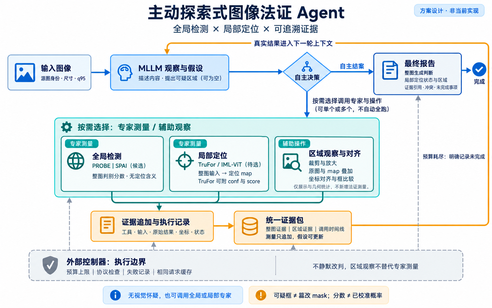

# 主动探索式图像法证 Agent：流程方案

更新日期：2026-11-02。本文描述拟议设计，不表示当前代码已经实现；SPAI 为候选，TruFor / IML-ViT 待评测选择。

实施顺序、数据范围和训练安排见[Claude Code 交接方案](../development/NEXT_WORKFLOW_20261102.md)。沿用当前机器，GenImage 用于基础全局开发，MNW/DIV2K 用于较新生成器评测，AutoSplice 用于局部检测与定位；统一 q95。AutoSplice 从 `Authentic＋Forged_JPEG100` 经同一编码流程派生输入，mask 保持无损。

## 1. 图像输入与初始观察

记录源图身份、尺寸及预处理条件；当前研究输入统一为 JPEG q95。MLLM 读取图像，描述内容，提出可能的怀疑和区域位置框。没有明确视觉异常时，可以不提出可疑框；这不妨碍后续调用全局或局部专家。

## 2. MLLM 自主选择行动

MLLM 根据图像、当前假设和已有观察，选择专家测量、辅助观察或结案。专家不默认全部执行。有具体局部怀疑时，建议优先调用定位专家验证，但不由外部控制器强制替模型选择。全局生成分数低不能排除局部篡改。

### 专家测量

- 全局检测：PROBE，以及评测准入后的 SPAI，接收整图，返回各自的整图判别分数与必要说明。分数不提供局部定位含义，也不自动等于经过校准的真假概率。
- 局部定位：按评测结果选用 TruFor / IML-ViT，通常接收整图，输出像素级定位 map。TruFor 可附可靠性 conf 和图像级 score；不能默认 IML-ViT 有同样的独立输出。候选框由固定后处理从 map 提取，同时保留原始 map。

### 区域观察与对齐（辅助操作）

这是一组确定性图像展示与几何处理功能，不是新增检测专家：

- 按原图坐标同步裁剪、放大原图和对应 map；仅观察局部时，无需重新运行定位专家。
- 将 map、候选框或 mask 叠加到原图，辅助理解空间位置。
- 处理原图、模型输入、裁剪图之间的坐标映射，记录输入产物和变换。
- 比较 MLLM 初始怀疑框与定位器候选框的重叠和覆盖关系。保留来源和提出时间；看过定位图后的框不能作为独立发现。

这些操作产生视图或几何统计，不新增独立法证测量。框重叠不等于证实篡改。需要新测量时，由 MLLM 另外调用适用专家；对裁剪图重新检测须先验证该专家的适用性，并记录输入条件变化。当前方案不新增泛化的“区域验证专家”。

## 3. 追加证据与执行记录

每次行动记录类型、工具或操作身份、实际输入、参数、输出产物、原图坐标和执行状态。专家测量与辅助观察分开标记；裁剪、叠加和框比较不计作新增独立专家证据。

统一证据包按整图证据、区域证据和调用时间线组织。历史测量只追加；MLLM 可以更新、撤销假设，但不能改写原始测量。整图分类分数不能自动归因到具体区域。

## 4. 返回观察并继续探索

当前行动的真实输出、必要可视化、结果说明和证据 ID 进入下一轮上下文。已有历史不重复投递；完整数组与中间产物留存于日志和文件。MLLM 判断证据是否支持假设、是否存在冲突，再选择继续调用、辅助观察或结案。

## 5. 自主结案与执行边界

最终报告分别描述整图生成判断、局部定位状态、支持证据、冲突及未完成事项。区分未测量、调用失败、未见明显异常，以及异常存在但定位未确认。可疑框和预测 map 不直接作为已确认篡改真值。

外部控制器负责预算、协议检查、失败记录及相同请求缓存。重复请求按专家、实际输入、参数和权重版本识别；相同请求可复用结果，缓存命中不算新测量。不同输入或参数是否允许重测，取决于专家适用性。

预算耗尽时，可明确请求 MLLM 基于已有证据总结并记录调查未完成；模型仍未给出结论时，保留未完成状态，不由控制器静默生成或修改真假标签。

## 设计依据与素材

本方案借鉴 EviGraph 的证据绑定、ATAR 的假设修正和 ForenAgent 的执行反馈闭环。正式图为本文开头的 PNG；旧版图片及生成提示词存放于 [forensic_agent_assets](forensic_agent_assets/)，仅用于保留绘制过程。
